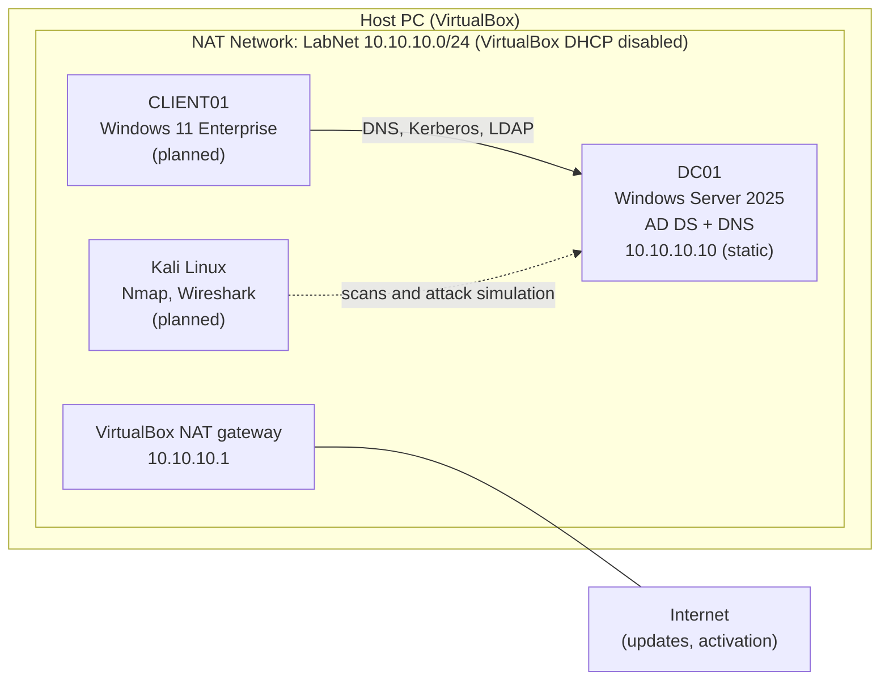

# Personal Enterprise Infrastructure Lab

A small, isolated Windows corporate network that I built from scratch in VirtualBox so I could learn how Active Directory, DNS and Group Policy actually work, and then attack and defend it.

Most of what I learned came from trial and error. This repo documents what I built, what broke, and how I worked out the fix.

> **Status:** work in progress. The domain controller is built and verified. DHCP, users and groups, a domain-joined Windows 11 client, attack simulation and log monitoring are next (see [Roadmap](#roadmap)).

---

## Lab architecture

| Component | Details |
| --- | --- |
| Hypervisor | Oracle VirtualBox 7.2 on a 16 GB RAM Windows PC |
| Network | VirtualBox **NAT Network** `LabNet`, `10.10.10.0/24`, gateway `10.10.10.1`, VirtualBox DHCP **disabled** |
| Domain controller | `DC01`, Windows Server 2025 Standard Evaluation (Desktop Experience), 2 vCPU, 3 GB RAM, 60 GB disk, UEFI |
| Domain | `lab.local` (NetBIOS `LAB`), single-domain forest |
| Roles on DC01 | Active Directory Domain Services, DNS Server |

**Why a NAT Network?** Plain NAT gives every VM its own isolated bubble, so the VMs can't see each other. A NAT Network puts all lab VMs on one shared subnet where they can talk to each other and reach the internet for updates, while nothing on my home network can reach them. That keeps attack practice contained.

---

## What I've built so far

1. **Created an isolated lab network** with `VBoxManage` from the command line, after the network manager had moved in the newer VirtualBox interface. ([details](docs/01-lab-network.md))
2. **Built DC01** on a clean Windows Server 2025 install, gave it a static IP, renamed it and activated it. ([details](docs/02-dc01-build.md))
3. **Promoted DC01 to a domain controller** for a new forest, `lab.local`, with integrated DNS. ([details](docs/02-dc01-build.md#promote-to-a-domain-controller))
4. **Verified the domain** by checking the AD, DNS and Netlogon services, the SOA record for `lab.local`, and the SRV records clients use to find a domain controller. ([details](docs/02-dc01-build.md#verification))

---

## Troubleshooting highlights

Full write-ups are in the [troubleshooting log](docs/03-troubleshooting-log.md).

| Problem | What I found | Fix |
| --- | --- | --- |
| VirtualBox wouldn't save the VM's network settings | The error showed the VM's folder didn't exist; an earlier folder-creation error had left a half-created VM registered | Unregistered the broken VM and recreated it in a folder outside the VirtualBox program directory |
| Server hung on "Restarting" after installing Guest Additions | The new display driver was the most likely cause | Switched the graphics controller to VBoxSVGA, raised video memory to 128 MB and disabled 3D acceleration via `VBoxManage`, then the server booted |
| Domain controller promotion hung on "Verifying prerequisites" | `dcpromo.log` didn't exist, so promotion hadn't started. `Resolve-DnsName` returned error 10054: the server was sending DNS queries to itself (127.0.0.1) before any DNS service existed | Temporarily pointed DNS at a public resolver and promoted with `-CreateDnsDelegation:$false`. Promotion then switched DNS back to itself automatically |

---

## Skills practised

- Windows Server 2025 installation and configuration
- Active Directory Domain Services: forest and domain creation
- DNS: zones, SOA and SRV records, forwarders, and why AD depends on DNS
- TCP/IP addressing: static IPs, subnetting, gateways, APIPA (169.254.x.x) diagnosis
- PowerShell for server configuration and verification
- VirtualBox networking and `VBoxManage` command-line administration
- Structured troubleshooting: reading errors and logs, forming and testing a hypothesis, changing one thing at a time, using snapshots for safe rollback

---

## Roadmap

- [x] Isolated lab network (`LabNet`)
- [x] DC01 built, static IP, activated
- [x] `lab.local` forest with integrated DNS, verified
- [ ] DNS forwarder and reverse lookup zone
- [ ] DHCP on DC01 (scope, options, authorization)
- [ ] OU structure, users, security groups and password/lockout policy via an idempotent PowerShell script
- [ ] Group-restricted file share and a baseline Group Policy
- [ ] Windows 11 client joined to the domain
- [ ] Kali VM: Nmap scans and Wireshark captures of DHCP, DNS, Kerberos and SMB
- [ ] Simulate password spraying against a test account and detect it in the domain controller's security logs
- [ ] Forward logs to a SIEM (Wazuh or Splunk) and write a detection rule

---

## Safety and ethics

Everything in this lab runs on an isolated virtual network that I own. Scanning and attack simulation are only ever pointed at machines inside `LabNet`. No credentials, keys or personal data are stored in this repository.
