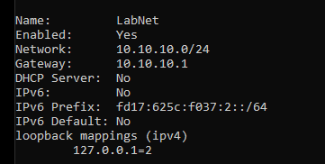

# 01 – Lab network

## Goal

Put every lab VM on one shared, isolated subnet that can reach the internet for updates but can't be reached from my home network.

## Design

| Setting | Value | Why |
| --- | --- | --- |
| Network type | VirtualBox **NAT Network** | VMs can see each other (unlike plain NAT) but stay isolated from the home LAN |
| Name | `LabNet` | |
| Subnet | `10.10.10.0/24` | 254 usable addresses, easy to read |
| Gateway | `10.10.10.1` | Provided by VirtualBox |
| VirtualBox DHCP | **Disabled** | DC01 will be the DHCP server. Two DHCP servers on one network would compete, and clients could get the wrong DNS server and fail to join the domain |

## What I did

In the newer VirtualBox 7.2 interface, the Network Manager was no longer under **File → Tools**, so I created the network from the command line instead.

`VBoxManage.exe` wasn't in the folder I expected, so I searched for it first:

```cmd
where /r D:\ VBoxManage.exe
```

Then I created and checked the network using the full path:

```cmd
"D:\VM\VBoxManage.exe" natnetwork add --netname LabNet --network "10.10.10.0/24" --enable --dhcp off
"D:\VM\VBoxManage.exe" natnetwork list
```

Result:

```
Name:         LabNet
Enabled:      Yes
Network:      10.10.10.0/24
Gateway:      10.10.10.1
DHCP Server:  No
```



## Attaching a VM to LabNet

When the network setting wouldn't change in the GUI, I attached the VM from the command line (the VM must be powered off):

```cmd
"D:\VM\VBoxManage.exe" modifyvm "DC01-V2" --nic1 natnetwork --nat-network1 LabNet
"D:\VM\VBoxManage.exe" showvminfo "DC01-V2" | findstr /i "NIC 1"
```

Expected output includes: `Attachment: NAT Network 'LabNet'`.

## What I learned

- **NAT vs NAT Network:** plain NAT isolates each VM from every other VM. NAT Network creates a shared segment, which is what a domain needs.
- When a GUI moves or misbehaves, the CLI (`VBoxManage`) is a reliable fallback, and it's scriptable.
- Small syntax details matter: a misplaced quote (`"D:\VM"VBoxManage`) produced "not recognized as an internal or external command". The error pointed at how the path was written, not at VirtualBox being missing.
