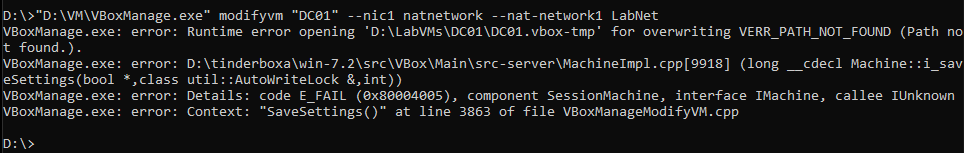
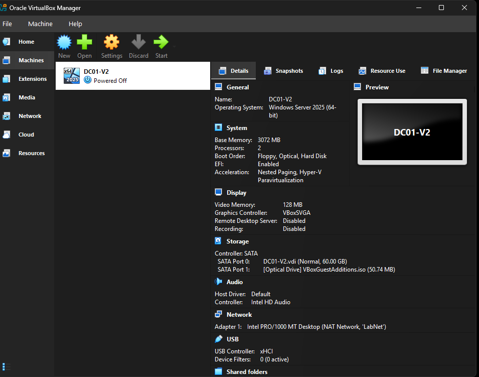
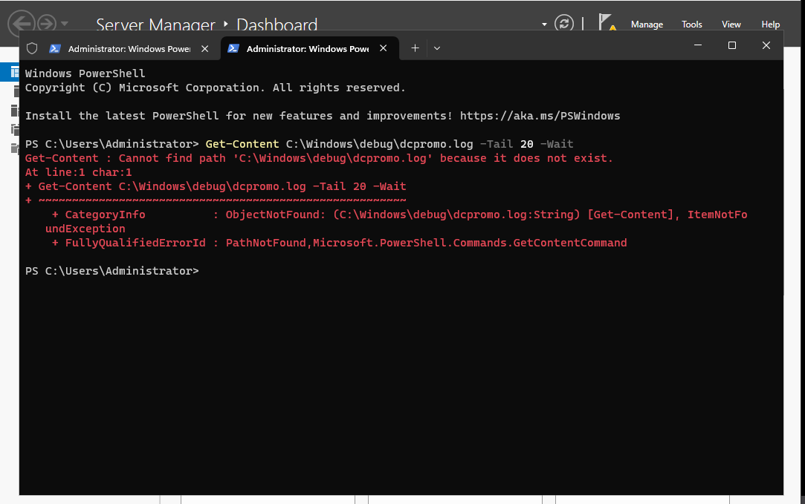
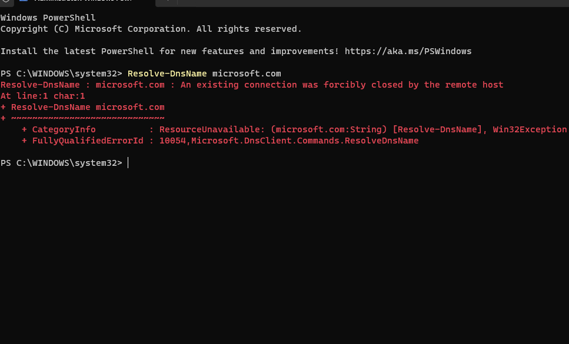
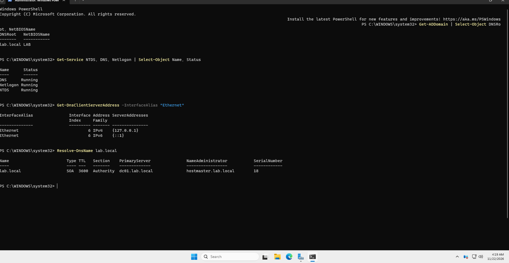
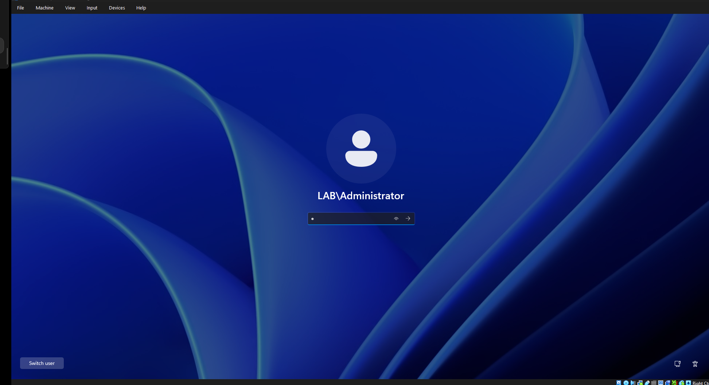

# 03 – Troubleshooting log

Each entry follows the same structure: what happened, what I first thought, what the evidence showed, and the fix.

---

## 1. VirtualBox wouldn't save the VM's network settings

**Symptom:** The network adapter stayed on "NAT" no matter what I chose in the GUI. Setting it from the command line failed:

```
VBoxManage.exe: error: Runtime error opening 'D:\LabVMs\DC01\DC01.vbox-tmp' for overwriting
VERR_PATH_NOT_FOUND (Path not found.)
```

**Evidence:** VirtualBox was trying to save settings into a folder that didn't exist. Earlier, creating the VM in `D:\VM\Machines` had failed with "Failed to create machine folder". That location sat inside the VirtualBox program folder. The VM was registered in VirtualBox, but its files were never written.

**Fix:** Removed the broken registration and recreated the VM in a dedicated folder outside the program directory (`D:\LabVMs`), then set the network from the CLI.

```cmd
"D:\VM\VBoxManage.exe" unregistervm "DC01"
```



**Lesson:** Read the full error. "Path not found" on a settings file pointed to a half-created VM, not a networking problem. Also, keep VM files separate from program files.

---

## 2. Server hung on "Restarting" after installing Guest Additions

**Symptom:** After installing VirtualBox Guest Additions, the server sat on "Restarting" for more than 10 minutes. A reset didn't help.

**First step:** Waited a reasonable time (driver installs can make the first reboot slow) before intervening, then escalated to a reset.

**Hypothesis:** Guest Additions replaces the display driver, so the display configuration was the most likely cause.

**Fix:** With the VM powered off, changed the display settings from the CLI:

```cmd
"D:\VM\VBoxManage.exe" modifyvm "DC01-V2" --graphicscontroller vboxsvga --vram 128 --accelerate-3d off
```

The server then booted normally. I took a snapshot (`dc01-fresh-install`) straight away so I'd never have to repeat a reinstall.



**Lesson:** Change one variable at a time, and snapshot known-good states before risky changes.

---

## 3. Domain controller promotion hung on "Verifying prerequisites"

**Symptom:** `Install-ADDSForest` sat on "Validating environment and user input / Verifying prerequisites for domain controller operation" for about 20 minutes.

**Investigation:**

1. Checked the promotion log to see what it was doing:
   ```powershell
   Get-Content C:\Windows\debug\dcpromo.log -Tail 20 -Wait
   ```
   The file **didn't exist**, so the promotion itself had never started. The problem was in the prerequisite check.
2. Cancelled with Ctrl+C (safe, because nothing had changed) and ran the check on its own with `Test-ADDSForestInstallation`. It hung in the same place, which confirmed the prerequisite step was the problem.
3. **Hypothesis:** DNS. DC01's DNS was set to itself (`127.0.0.1`), but the DNS Server role wasn't installed yet, so every lookup the check made would fail or time out.
4. Tested it:
   ```powershell
   Resolve-DnsName microsoft.com
   ```
   ```
   An existing connection was forcibly closed by the remote host (10054)
   ```
   This confirmed it: queries were going to 127.0.0.1, where nothing was listening.





**Fix:**

```powershell
Set-DnsClientServerAddress -InterfaceAlias "Ethernet" -ServerAddresses 1.1.1.1
Resolve-DnsName microsoft.com     # now returned A and AAAA records
Install-ADDSForest -DomainName "lab.local" -DomainNetbiosName "LAB" -InstallDns -CreateDnsDelegation:$false
```

- Temporarily pointing DNS at a public resolver let the prerequisite lookups succeed.
- `-CreateDnsDelegation:$false` stopped it trying to register `lab.local` with a parent `.local` zone, which doesn't exist for an internal-only domain.

Promotion completed. Afterwards, `Get-DnsClientServerAddress` showed DC01's DNS had been switched back to `127.0.0.1` automatically, which is the correct setting for a domain controller.



**Lesson:** Active Directory depends on DNS at every stage, even during setup. Checking the log first told me where to look, and testing one hypothesis directly (`Resolve-DnsName`) turned a vague hang into a specific, fixable error.

---

## 4. Server wouldn't shut down from the login screen

**Symptom:** DC01 sat at the `LAB\Administrator` login screen and wouldn't power off from there.

**What I found:** On Windows Server, the option to shut down without logging in is turned off by default (security policy "Shutdown: Allow system to be shut down without having to log on"). It's a deliberate hardening default, so nobody can power off a server from the console without authenticating.

**Fix:** Logged in and shut down from the Start menu with a planned reason. I avoided a hard power-off, because cutting power to a domain controller while the Active Directory database is open risks corrupting it.



**Lesson:** Not every "it won't do what I want" is a bug. Sometimes it's a security control, so find out why before forcing it.
